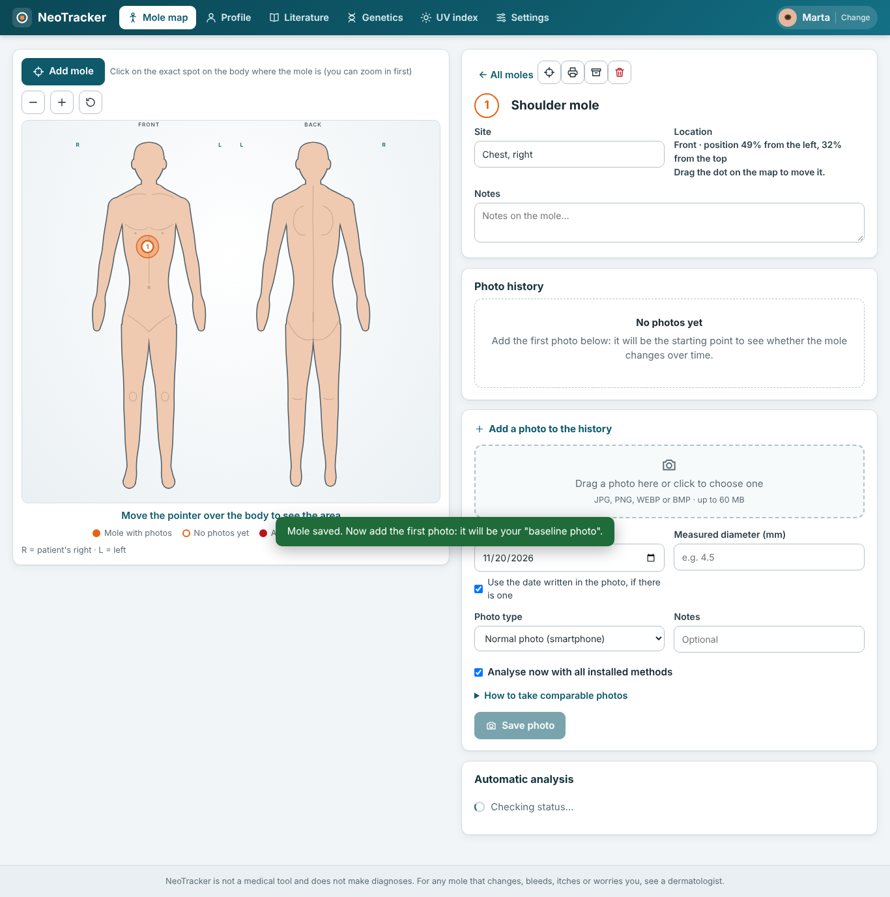
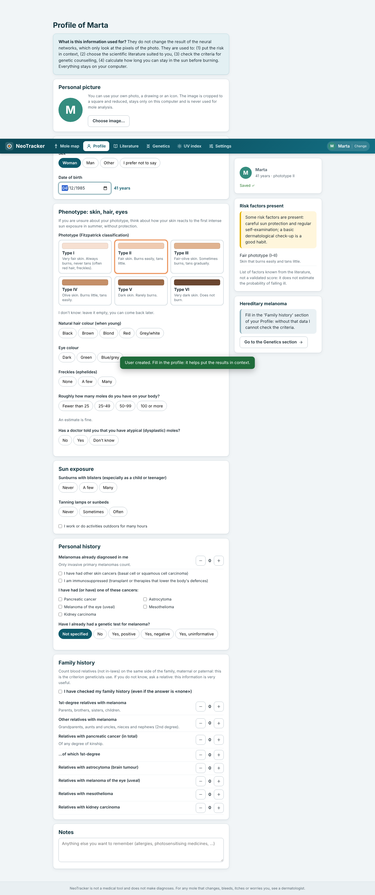

# NeoTracker

**Body map, photo history of your moles, multi-model analysis, literature, genetics and UV index: all on your own computer.**

[](https://github.com/marco929618/NeoTracker/actions/workflows/ci.yml)
[](https://github.com/marco929618/NeoTracker/actions/workflows/codeql.yml)
[](LICENSE)

> ⚠️ **NeoTracker is NOT a medical device and does NOT diagnose.** The models it uses are unvalidated research
> prototypes and can be wrong in both directions. Any mole that changes, bleeds, itches or worries you must be
> shown to a dermatologist, whatever the program says. Read [DISCLAIMER.md](DISCLAIMER.md).

<p align="center">
  
  
</p>

*(Screenshots with made-up data.)*

## What it does

- **Five languages**: English, Italian, French, German and Spanish. The interface starts in your system language and is
  changed in *Settings → Language* (it applies to all users). The body map, notices, genetic criteria and the printable
  sheet are translated too; the English text of the legal notices prevails.
- **Several users** on the same PC, each with an optional **personal picture**, a profile (phototype, hair, eyes, moles,
  family history) and separate data.
- **Interactive body map** (front and back): click where the mole is and the point is saved precisely.
- **Photo history** for each mole: original photos kept unmodified, with date, diameter and notes; comparison of two
  dates; **printable sheet** for the dermatologist.
- **Automatic analysis** of each photo with all the installed methods (`melanoma_batch.py`), with a report saying what
  each method answered.
- **Scientific literature** (PubMed) on mole recognition and hereditary melanoma, and **criteria to evaluate genetic
  counselling** (CDKN2A, CDK4 genes, etc.).
- **UV index** of the day for your location (Open-Meteo, free and keyless; OpenWeather optional) with conservative
  sun-exposure times by phototype.
- **A real program window**: no address bar, icon in the taskbar, it shuts itself down when you close it. It works
  locally (`127.0.0.1`): **no account, no server, no telemetry**.

## Requirements

- Windows 10/11 with **Edge** or **Chrome** (usually already present) and **Python 3.9+** ([python.org](https://www.python.org/downloads/), tick *Add python.exe to PATH*).
- Recommended: `py -m pip install -U "pillow>=10.3.0"` (photo previews and rotation).
- For the **mole analysis** you need the third-party projects, installed by `tools/install_melanoma_repos.ps1`
  (see [THIRD_PARTY_NOTICES.md](THIRD_PARTY_NOTICES.md)): they take a few GB and some patience.
  **Without them NeoTracker still works** (map, history, UV, literature): only the analysis is missing.

It also works on Linux/macOS with a Chromium browser, but it is developed and tested mainly for Windows.

## Quick start

```bat
git clone https://github.com/marco929618/NeoTracker.git
cd NeoTracker
py -3 neotracker.py
```

The first time, a notice (it is not a medical tool) appears and must be accepted. To get the icon on the Desktop,
double-click `Crea_scorciatoia_Desktop.bat`. If something goes wrong, `NeoTracker.bat` shows the program messages and
the `neotracker.log` file in the data folder tells you what happened.

**Your data** lives in `%USERPROFILE%\melanoma-repos\NeoTracker_dati` (it can be changed with the `NEOTRACKER_DATI`
environment variable). To back up, copy that folder. It is not part of the repository and `.gitignore` excludes it.

## Mole analysis: installing the methods

```powershell
powershell -ExecutionPolicy Bypass -File tools\install_melanoma_repos.ps1
```

It clones the original repositories (each with its own licence) into `%USERPROFILE%\melanoma-repos`, prepares a virtual
environment for each and downloads the models. Then, in NeoTracker, open a mole, upload a photo and leave
*Analyse this photo* ticked. From the command line: `py melanoma_batch.py --foto "C:\path\mole.jpg"`.

> The **SkinSense** method sends the photo to a third-party online service: it is **off by default** and you turn it on
> in Settings. Before sending, the photo is re-encoded without metadata (no GPS).

## Privacy and security in brief

- Everything stays on your PC; only the requests you turn on leave it → [PRIVACY.md](PRIVACY.md).
- Server only on `127.0.0.1`, random session key, strict CSP, checked uploads → [SECURITY.md](SECURITY.md).
- Health data is **not encrypted** by the program: use BitLocker and an account with a password.

## Development

```text
src/          parts of the program (Python)         web/    page (HTML, CSS, JavaScript)
build.py      joins everything into a single file   tests/  automated tests
neotracker.py the ready-to-run program (generated: do not edit it by hand)
```

```bash
python build.py                       # regenerates neotracker.py from src/ and web/
python tests/test_sicurezza.py        # security tests (no external dependency apart from Pillow)
python tests/test_finestra.py         # window life cycle
python tests/test_api.py              # full backend test with mock services
python tests/test_i18n.py             # languages: complete dictionaries, setting, served page
python tools/traduzioni.py            # checks that every text is translated into all languages
```

`tests/e2e.py`, `tests/e2e_lingue.py` and `tests/test_vita.py` test the app in a real browser and need Playwright and
Chrome (see [tests/README.md](tests/README.md)). The program uses only the Python standard library (Pillow is optional).

Contributions are welcome: read [CONTRIBUTING.md](CONTRIBUTING.md).

## License

[GNU General Public License v3.0 or later](LICENSE). Third-party components and services with their own terms:
[THIRD_PARTY_NOTICES.md](THIRD_PARTY_NOTICES.md). If you use NeoTracker in research work, see [CITATION.cff](CITATION.cff).

UV index data: [Open-Meteo.com](https://open-meteo.com/) (CC BY 4.0, non-commercial use).
