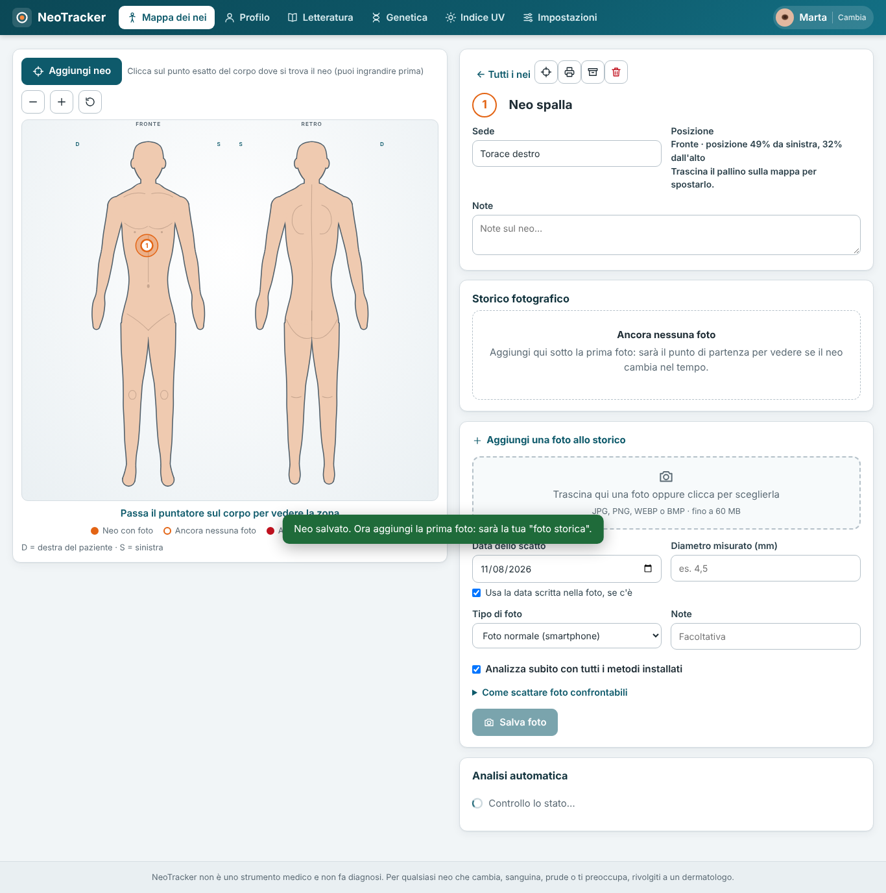
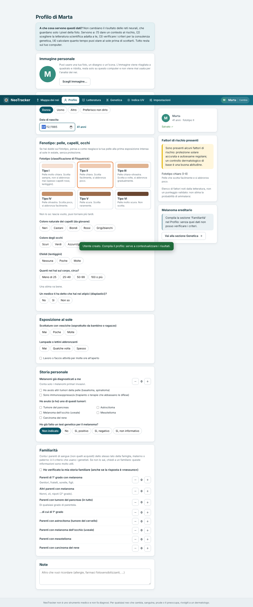

# NeoTracker

**Mappa del corpo, storico fotografico dei nei, analisi con più modelli, letteratura, genetica e indice UV: tutto sul tuo computer.**

[](https://github.com/marco929618/NeoTracker/actions/workflows/ci.yml)
[](https://github.com/marco929618/NeoTracker/actions/workflows/codeql.yml)
[](LICENSE)

> ⚠️ **NeoTracker non è un dispositivo medico e non fa diagnosi.** I modelli usati sono prototipi di ricerca
> non validati: possono sbagliare in entrambe le direzioni. Un neo che cambia, sanguina, prude o ti preoccupa va
> mostrato a un dermatologo, qualunque cosa dica il programma. Leggi [DISCLAIMER.md](DISCLAIMER.md).
> *English summary: [README.en.md](README.en.md).*

<p align="center">
  
  
</p>

*(Schermate con dati inventati.)*

## Che cosa fa

- **Più utenti** sullo stesso PC, ciascuno con la propria **immagine personale** facoltativa, profilo (fototipo, capelli,
  occhi, nei, familiarità) e dati separati.
- **Mappa interattiva del corpo** (fronte e retro): clicchi dove sta il neo e il punto resta salvato con precisione.
- **Storico fotografico** per ogni neo: foto originali conservate senza modifiche, con data, diametro e note;
  confronto tra due date; **scheda stampabile** per il dermatologo.
- **Analisi automatica** di ogni foto con tutti i metodi installati (`melanoma_batch.py`), con un rapporto che dice
  cosa ha risposto ciascun metodo.
- **Letteratura scientifica** (PubMed) su riconoscimento dei nei e melanoma ereditario, e **criteri per valutare una
  consulenza genetica** (geni CDKN2A, CDK4, ecc.).
- **Indice UV** del giorno nel tuo luogo (Open-Meteo, gratuito e senza chiave; OpenWeather a scelta) con i tempi
  prudenti di esposizione per fototipo.
- **Finestra di programma vera**: niente barra degli indirizzi, icona nella barra delle applicazioni, si spegne
  da solo quando la chiudi. Funziona in locale (`127.0.0.1`): **nessun account, nessun server, nessuna telemetria**.

## Requisiti

- Windows 10/11 con **Edge** o **Chrome** (già presenti di solito) e **Python 3.9+** ([python.org](https://www.python.org/downloads/), spunta *Add python.exe to PATH*).
- Consigliato: `py -m pip install -U "pillow>=10.3.0"` (anteprime e rotazione delle foto).
- Per l'**analisi dei nei** servono i progetti di terzi, installati da `tools/install_melanoma_repos.ps1`
  (vedi [THIRD_PARTY_NOTICES.md](THIRD_PARTY_NOTICES.md)): richiedono qualche GB e un po' di pazienza.
  **Senza di essi NeoTracker funziona lo stesso** (mappa, storico, UV, letteratura): manca solo l'analisi.

Funziona anche su Linux/macOS con un browser Chromium, ma è sviluppato e provato soprattutto per Windows.

## Avvio rapido

```bat
git clone https://github.com/marco929618/NeoTracker.git
cd NeoTracker
py -3 neotracker.py
```

La prima volta compare un avviso (non è uno strumento medico) da accettare. Per avere l'icona sul Desktop,
doppio clic su `Crea_scorciatoia_Desktop.bat`. Se qualcosa non va, `NeoTracker.bat` mostra i messaggi del programma e
il file `neotracker.log` nella cartella dei dati racconta cosa è successo.

**I tuoi dati** stanno in `%USERPROFILE%\melanoma-repos\NeoTracker_dati` (cambiabile con la variabile d'ambiente
`NEOTRACKER_DATI`). Per il backup copia quella cartella. Non fanno parte del repository e il `.gitignore` li esclude.

## Analisi dei nei: installare i metodi

```powershell
powershell -ExecutionPolicy Bypass -File tools\install_melanoma_repos.ps1
```

Clona i repository originali (ognuno con la sua licenza) in `%USERPROFILE%\melanoma-repos`, prepara un ambiente
virtuale per ciascuno e scarica i modelli. Poi, in NeoTracker, apri un neo, carica una foto e lascia spuntata
*«Analizza»*. Da riga di comando: `py melanoma_batch.py --foto "C:\percorso\neo.jpg"`.

> Il metodo **SkinSense** invia la foto a un servizio online di terzi: è **disattivato di default** e lo attivi tu nelle
> Impostazioni. Prima dell'invio la foto viene ricodificata senza metadati (niente GPS).

## Privacy e sicurezza in breve

- Tutto resta sul tuo PC; escono solo le richieste che attivi tu → [PRIVACY.md](PRIVACY.md).
- Server solo su `127.0.0.1`, chiave di sessione casuale, CSP rigida, caricamenti controllati → [SECURITY.md](SECURITY.md).
- I dati sulla salute **non sono cifrati** dal programma: usa BitLocker e un account con password.

## Sviluppo

```text
src/          pezzi del programma (Python)          web/    pagina (HTML, CSS, JavaScript)
build.py      unisce tutto in un solo file          tests/  prove automatiche
neotracker.py il programma pronto da eseguire (generato: non modificarlo a mano)
```

```bash
python build.py                       # rigenera neotracker.py da src/ e web/
python tests/test_sicurezza.py        # prove di sicurezza (nessuna dipendenza esterna oltre a Pillow)
python tests/test_finestra.py         # ciclo di vita della finestra
python tests/test_api.py              # prova completa del backend con servizi finti
```

`tests/e2e.py` e `tests/test_vita.py` provano l'app in un vero browser e richiedono Playwright e Chrome
(vedi [tests/README.md](tests/README.md)). Il programma usa solo la libreria standard di Python (Pillow è facoltativo).

Contributi benvenuti: leggi [CONTRIBUTING.md](CONTRIBUTING.md).

## Licenza

[GNU General Public License v3.0 o successiva](LICENSE). Componenti e servizi di terze parti con le loro condizioni:
[THIRD_PARTY_NOTICES.md](THIRD_PARTY_NOTICES.md). Se usi NeoTracker in un lavoro di ricerca, vedi [CITATION.cff](CITATION.cff).

Dati dell'indice UV: [Open-Meteo.com](https://open-meteo.com/) (CC BY 4.0, uso non commerciale).
